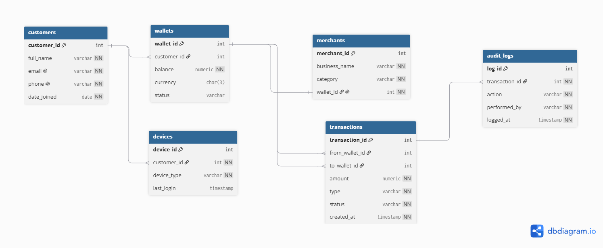

# Portfolio 1: Database Design and Modelling

## What this folder contains

| File | Purpose |
|---|---|
| 01_create_tables.sql | Creates the 6 tables with primary keys, foreign keys and constraints |
| 02_sample_data.sql | Inserts sample customers, wallets, a merchant and devices |
| 03_constraint_tests.sql | Inserts that are expected to fail, proving the constraints work |
| er_diagram.png | Entity relationship diagram |
| Screenshots | Evidence of tables, data and constraint tests |

## ER Diagram

## Entities and relationships

- **Customer to Wallet (1:M):** a customer can hold several wallets, e.g. NGN and USD.
- **Customer to Device (1:M):** a customer can log in from several phones.
- **Wallet to Transaction (1:M, twice):** each transaction has a sending wallet and a receiving wallet.
- **Merchant to Wallet (1:1):** each merchant has exactly one wallet for receiving payments.
- **Transaction to Audit Log (1:M):** each transaction can have several log entries.

## Key design decisions

- **Money uses NUMERIC(14,2), not FLOAT,** because floating-point types cause small rounding errors that are unacceptable in finance.
- **Wallet customer_id can be NULL,** because merchant wallets are not owned by a customer.
- **Transaction wallets can be NULL,** because deposits have no sending wallet and withdrawals have no receiving wallet. A CHECK constraint ensures at least one wallet is always involved.
- **Balance is stored in the wallet** even though it could be calculated from transactions. This is a deliberate trade-off for speed; consistency between balances and transactions will be protected using transactions in Portfolio 3.

## Normalisation

The design is in Third Normal Form (3NF):
- **1NF:** every column holds a single value; multiple devices are stored as separate rows in the devices table.
- **2NF:** every table uses a single-column primary key, so no partial dependencies exist.
- **3NF:** no column depends on another non-key column; for example, customer names are stored only in customers, and wallets reference them by customer_id.

## How it was implemented and tested

1. Created the `veltrix` database in PostgreSQL 17 using pgAdmin 4.
2. Ran `01_create_tables.sql` to build the 6 tables.
3. Ran `02_sample_data.sql` and checked the data with SELECT queries.
4. Ran each test in `03_constraint_tests.sql` one at a time.

| Test | Constraint tested | Result |
|---|---|---|
| Duplicate email | UNIQUE (customers_email_key) | Rejected as expected |
| Negative balance | CHECK (wallets_balance_check) | Rejected as expected |
| Wallet for customer 99 | FOREIGN KEY (wallets_customer_id_fkey) | Rejected as expected |

**Observation:** the rejected wallet insert still used up ID 5, so the next wallet receives ID 6. PostgreSQL assigns identity values before checking constraints, so gaps in IDs are normal and do not indicate missing data.
